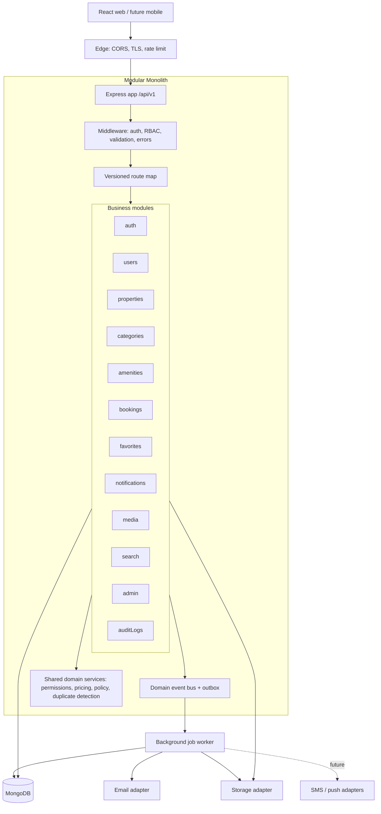
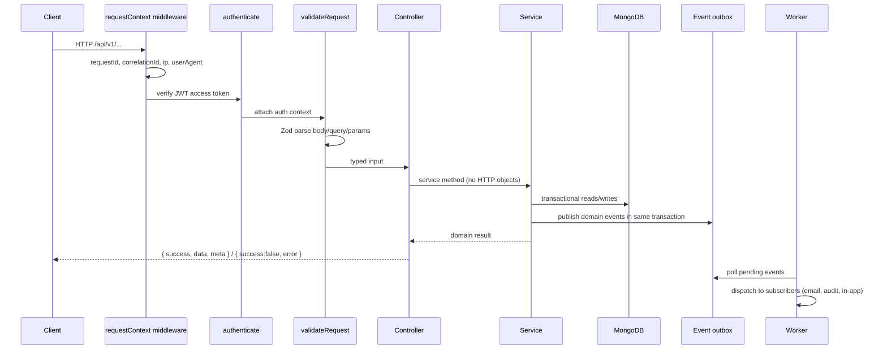
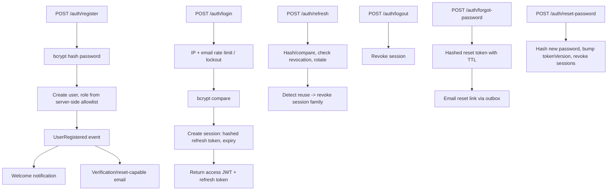
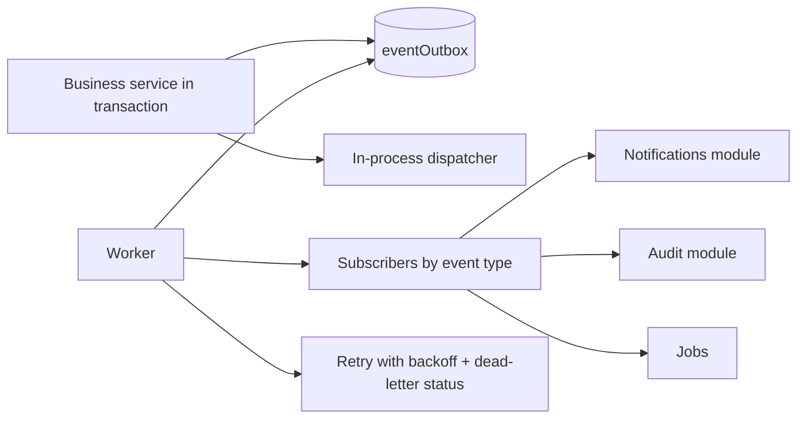

# Document 1 — System Architecture (Phase 2)

## 1. Architecture overview

A **modular monolith** with strict module boundaries. Modules are independently testable and can be extracted into services later because they communicate through:

1. **Public service interfaces** for synchronous domain queries (`bookings → properties.getBookableSnapshot`).
2. **Domain events** for side effects (`BookingConfirmed → notifications, auditLogs, jobs`).
3. **Infrastructure adapters** for external providers (`email`, `storage`, `jobs`).



### Why a modular monolith

- One deployment, one database, simple operations for V1.
- Cross-module transactions are real MongoDB transactions, avoiding distributed consistency problems in booking workflows.
- Extraction path is explicit: module exposes a service interface and publishes events; replacing in-process calls with HTTP/gRPC later does not change business rules.
- Avoids premature microservices infrastructure (service mesh, distributed tracing, per-service databases).

## 2. Module responsibilities and interfaces

| Module | Owns | Exposes (public interface) | Consumes | Publishes events |
|---|---|---|---|---|
| `auth` | `users` credential fields, `sessions`, `passwordResetTokens`, token strategy | `register()`, `login()`, `rotateRefreshToken()`, `verifyAccessToken()`, `invalidateSessions()` | `users`, `notifications` | `UserRegistered`, `PasswordResetRequested`, `PasswordChanged`, `UserLoggedIn` |
| `users` | User profiles, lifecycle, `deletionRequests` | `getUserById()`, `getPublicProfile()`, `requestDeletion()`, `isActive()` | `auth`, `bookings` (active-booking check) | `AccountDeletionRequested`, `AccountDeletionResolved`, `UserSuspended` |
| `categories` | `propertyCategories`, category attribute schemas | `getCategoryById()`, `validateAttributes(categoryId, attrs)`, `listActive()` | `admin` (management) | `CategoryCreated`, `CategoryUpdated`, `CategoryDeactivated` |
| `amenities` | `amenities`, category associations | `listActive(ids?)`, `validateIds(ids)`, `getSnapshot(ids)` | `properties`, `search` | `AmenityCreated`, `AmenityUpdated`, `AmenityDeactivated` |
| `properties` | `properties`, `approvalHistory`, `propertyChangeRequests`, `duplicateFlags`, duplicate strategy | `createDraft()`, `submitForApproval()`, `approve()`, `reject()`, `updateOwn()`, `getBookableSnapshot()`, `archive()`, `applyChangeRequest()` | `categories`, `amenities`, `media`, `admin` (audit via events) | `PropertySubmitted`, `PropertyApproved`, `PropertyRejected`, `PropertyUpdated`, `PropertyArchived`, `DuplicateFlagged` |
| `media` | `media`, storage adapter calls | `attachMedia()`, `removeMedia()`, `setCover()`, `reorder()`, `getCover()` | `properties` | `MediaAttached`, `MediaRemoved`, `MediaCleanupRequested` |
| `bookings` | `bookings`, `availabilityReservations`, `bookingHistory`, pricing orchestration, state machine | `createBooking()`, `approveBooking()`, `rejectBooking()`, `requestCancellation()`, `cancelBooking()`, `completeBooking()`, `getAvailability()` | `properties`, `users`, `pricing` (internal), `policy` (internal) | `BookingRequested`, `BookingConfirmed`, `BookingRejected`, `CancellationRequested`, `BookingCancelled`, `BookingCompleted` |
| `favorites` | `favorites` | `add()`, `remove()`, `list()`, `isFavorite()` | `properties` (availability/status) | `FavoriteAdded`, `FavoriteRemoved` |
| `notifications` | `notifications`, email templates, channel adapters, event subscribers | `createInApp()`, `unreadCount()`, `markRead()`, `sendEmail()` | event bus, `users` | `NotificationCreated`, `EmailDispatchFailed` |
| `search` | read models/queries for property discovery | `searchProperties(query)`, `mapSearch(bbox)` | `properties`, `categories`, `amenities` | none (read-only) |
| `admin` | `settings`, permission registry, admin account creation | `createAdmin()`, `getSettings()`, `updateSettings()` | `auth`, `users`, `auditLogs` | `AdminCreated`, `SettingsChanged` |
| `auditLogs` | `auditLogs` append-only store | `record(entry)`, `query(filter)` | event bus | none |

### Ownership rules for module data

- Only the owning module writes its collections. Other modules read through the owner's service interface.
- Cross-module writes happen via events or explicit service calls, never via direct `Model.updateOne` from another module.
- `index.js` in each module exports only the public surface; internal files are not imported across modules.
- Dependency direction is layered: `routes → controllers → services → repositories → models`, with `shared/` and `infrastructure/` at the bottom. No module imports controllers or routes from another module.

## 3. Folder structure

```text
backend/
├── src/
│   ├── config/
│   │   ├── environment.js          # validated env vars, fail fast
│   │   ├── database.js             # connection, pool, health
│   │   ├── appConfig.js            # feature flags, limits, defaults
│   │   └── providers.js            # adapter selection by config
│   ├── modules/
│   │   ├── auth/
│   │   │   ├── auth.model.js       # Session, PasswordResetToken schemas
│   │   │   ├── auth.service.js
│   │   │   ├── auth.controller.js
│   │   │   ├── auth.routes.js
│   │   │   ├── auth.validation.js
│   │   │   ├── auth.constants.js
│   │   │   ├── token.service.js
│   │   │   └── index.js            # public interface only
│   │   ├── users/                  # user.model, user.service, deletionRequest.model, ...
│   │   ├── properties/             # property.model, approvalHistory.model,
│   │   │                           # changeRequest.model, duplicateFlag.model,
│   │   │                           ├── duplicateDetection/
│   │   │                           │   ├── index.js
│   │   │                           │   └── strategies/
│   │   │                           ├── property.service.js
│   │   │                           ├── property.repository.js
│   │   │                           ├── availabilityProjection.service.js
│   │   │                           └── index.js
│   │   ├── categories/
│   │   ├── amenities/
│   │   ├── bookings/
│   │   │   ├── booking.model.js
│   │   │   ├── reservation.model.js
│   │   │   ├── bookingHistory.model.js
│   │   │   ├── booking.service.js
│   │   │   ├── availability.service.js
│   │   │   ├── pricing.service.js  # V1 calculation, V2 rule engine boundary
│   │   │   ├── policy.service.js   # cancellation/modification rules
│   │   │   ├── booking.stateMachine.js
│   │   │   ├── booking.controller.js
│   │   │   ├── booking.routes.js
│   │   │   ├── booking.validation.js
│   │   │   └── index.js
│   │   ├── favorites/
│   │   ├── notifications/
│   │   ├── media/
│   │   ├── admin/
│   │   ├── search/
│   │   └── auditLogs/
│   ├── middleware/
│   │   ├── authenticate.js
│   │   ├── authorize.js            # permission-based, not role-string checks
│   │   ├── validateRequest.js
│   │   ├── rateLimiter.js
│   │   ├── requestContext.js       # requestId, actor, correlationId
│   │   └── errorHandler.js
│   ├── shared/
│   │   ├── constants/              # roles, statuses, periods, actions, event names
│   │   ├── errors/                 # ApiError, error codes, notFound/forbidden helpers
│   │   ├── validators/             # reusable Zod primitives (objectId, date, money)
│   │   ├── services/               # permissions, pagination, money, dates, ids
│   │   └── utils/                  # pure utilities only
│   ├── infrastructure/
│   │   ├── email/
│   │   │   ├── emailProvider.interface.js
│   │   │   ├── smtp.provider.js
│   │   │   └── templates/
│   │   ├── storage/
│   │   │   ├── storageProvider.interface.js
│   │   │   └── cloudinary.provider.js
│   │   ├── events/
│   │   │   ├── eventBus.interface.js
│   │   │   ├── inProcessEventBus.js
│   │   │   └── outbox.js
│   │   ├── jobs/
│   │   │   ├── jobQueue.interface.js
│   │   │   ├── inProcessQueue.js   # V1, backed by eventOutbox collection
│   │   │   └── handlers/
│   │   ├── logging/
│   │   └── monitoring/
│   ├── database/
│   │   ├── migrations/
│   │   ├── seeders/
│   │   └── indexes/
│   ├── routes/
│   │   ├── index.js                # mounts /api/v1 and future /api/v2
│   │   ├── v1.js                   # composed from module route files
│   │   └── health.js
│   ├── app.js                      # express setup, middleware, routes, error handler
│   └── server.js                   # listen, graceful shutdown, DB connect
├── tests/
│   ├── unit/
│   ├── integration/
│   ├── e2e/
│   ├── factories/
│   └── helpers/
├── .env.example
├── package.json
└── README.md
```

Each module follows the same internal contract: `model(s)`, `repository` where query complexity justifies it, `service` (business rules), `controller` (HTTP only), `validation`, `routes`, `constants`, `events`, `index.js`.

## 4. Request lifecycle



Rules:

- Controllers never touch Mongoose models directly.
- Services never read `req` or `res`; they accept plain objects and actor context.
- Validation happens before services; services also re-validate critical business invariants.
- All list endpoints paginate; no unbounded responses.

## 5. Authentication architecture



- Access JWT payload: `{ sub, roles, sid, ver, iat, exp }`; `sid` = session id, `ver` = user `tokenVersion`.
- Authorization checks `sid` and `ver` against current state for sensitive operations (or uses a short cache with revocation list) so logout/password change takes effect quickly.
- Refresh tokens are opaque, high-entropy, stored only as hashes; rotation detects reuse and revokes the family.
- `tokenVersion` on the user is the global kill switch (password change, suspension, deletion).
- Future 2FA: `auth` owns a step-up challenge; `authorize()` can require an `mfa` assertion in the token without changing business modules.

## 6. Authorization architecture

- Single permission registry: `shared/constants/permissions.js` defines canonical action names such as `property.approve`, `booking.cancel.any`, `user.suspend`.
- Roles map to permission sets in one place; `user.extraPermissions`/`deniedPermissions` are reserved for future granular roles.
- `authorize('property.update.own')` middleware checks permission + resource ownership via the owning module's service (`properties.isOwner(propertyId, actorId)`).
- No `if (role === 'admin')` checks in controllers/services; only the permission registry knows role→permission mapping.
- Ownership checks are mandatory for customer/owner routes and always re-read from DB.
- Admin-created resources still pass through the same services (D3 in `00-requirements-analysis.md`).

## 7. Event system and reliable delivery



Event envelope:

```json
{
  "eventId": "uuid",
  "type": "BookingConfirmed",
  "version": 1,
  "occurredAt": "2026-11-26T10:00:00.000Z",
  "actor": { "userId": "...", "role": "customer" },
  "correlationId": "requestId-from-http",
  "idempotencyKey": "booking:...:confirmed",
  "payload": { "bookingId": "...", "propertyId": "...", "customerId": "..." }
}
```

- The event bus interface is `publish(event)` / `subscribe(type, handler)`. V1 uses an in-process dispatcher plus a Mongo outbox. A future Redis/Kafka adapter implements the same interface.
- Critical events (booking, approval, deletion) are inserted into `eventOutbox` **inside the business transaction**, so a committed business action cannot lose its notification/audit event.
- Handlers must be idempotent using `eventId`/`idempotencyKey`; dispatcher records `processedAt`, `attempts`, `lastError`, `status` (`pending|processing|done|failed|dead`).
- Email provider failure never rolls back a booking; it retries asynchronously and records failure. In-app notifications are written by a subscriber that is idempotent.
- Event payloads contain IDs, never passwords/tokens/full sensitive documents.

## 8. Background jobs

Job layer interface: `enqueue(type, payload, options)` and handlers registered by name.

| Job | Trigger | Idempotency |
|---|---|---|
| `sendEmail` | Event subscriber | keyed by `eventId + template + recipient` |
| `sendInAppNotification` | Event subscriber | keyed by `eventId + userId` |
| `expirePendingBookings` | scheduled (policy disabled in V1) | status guard |
| `cleanupSessions` | scheduled | deletes expired sessions, TTL index also present |
| `cleanupOrphanedMedia` | event `MediaRemoved` / scheduled | provider check before delete |
| `refreshAvailabilityProjection` | booking/owner-block events + nightly | computed from reservations |
| `detectDuplicates` | `PropertySubmitted`/`PropertyUpdated` | keyed by property + strategy version |
| `generateReport` | admin request | keyed by report request id |
| `reconcilePayments` | future | keyed by provider event id |

V1 uses a MongoDB-backed queue/worker in the same process family; the job interface allows swapping to BullMQ/Redis without touching business services.

## 9. External integrations (provider abstraction)

| Concern | Interface | V1 adapter | Future adapters |
|---|---|---|---|
| Email | `EmailProvider { send(message) }` | SMTP provider | SendGrid, SES, postal |
| Object storage | `StorageProvider { signUpload, delete, getMetadata }` | Cloudinary | S3, GCS |
| Events | `EventBus` | in-process + Mongo outbox | Redis Streams, Kafka |
| Jobs | `JobQueue` | Mongo-backed | BullMQ/Redis, SQS |
| Search | `PropertySearchRepository` | MongoDB aggregation | Elasticsearch, Typesense |
| Cache | `CacheProvider` | none/no-op | Redis |
| Rate limit | `RateLimiter` | in-memory/Mongo | Redis |
| SMS/push/WhatsApp | `NotificationChannel` | none | Twilio, FCM, WhatsApp BSP |

Business modules depend on interfaces injected at composition time, never on provider SDKs.

## 10. Error handling and API responses

- `ApiError(statusCode, code, message, details?)` subclasses: `ValidationError`, `UnauthorizedError`, `ForbiddenError`, `NotFoundError`, `ConflictError`, `RateLimitError`.
- Central `errorHandler` logs with `requestId` and returns a safe envelope:

```json
{ "success": false, "error": { "code": "BOOKING_DATE_CONFLICT", "message": "Selected dates are no longer available", "details": [], "requestId": "..." } }
```

Success envelope:

```json
{ "success": true, "data": {}, "meta": { "page": 1, "limit": 20, "total": 42, "totalPages": 3 } }
```

- No stack traces, driver errors, or internal field names in production responses.
- Mongoose duplicate key errors are translated to domain conflict codes at the repository boundary.
- Unknown errors → `500 INTERNAL_ERROR` with a logged correlation id.

## 11. Logging, monitoring, and security headers

- Structured JSON logs with `requestId`, `actorId`, `method`, `path`, `status`, `durationMs`; redact password/token/authorization fields.
- Health endpoints: `/health/live`, `/health/ready` (DB + queue check).
- Metrics extension point: request duration, error rate, booking conflicts, outbox lag, job failures.
- `helmet`-equivalent headers, strict CORS allowlist, body size limits, trusted proxy config.
- Upload validation: MIME allowlist, magic-byte check where practical, size cap, provider-generated public IDs, no user-controlled file paths.

## 12. Testability built into the design

- Services are pure orchestration over injected repositories/adapters, so unit tests mock models and providers.
- Repository layer isolates Mongoose query syntax from business services.
- Integration tests use a real MongoDB test database and mimic replica-set transactions where available.
- Event handlers are individually testable; outbox processing can be asserted without sending real email.
- Every state transition in property/booking/user lifecycles is a named function with explicit allowed transitions, making invalid-transition tests straightforward.
