# Document 3 — Database Relationship Diagram (Phase 3)

## 1. ER-style diagram

Cardinality notation: `||` exactly one, `o|` zero or one, `}|` one or more, `o{` zero or many. Solid relationships are **references by ObjectId**. Embedded structures are listed after the diagram and are shown with `..` dotted lines for readability (they are not separate collections).

```mermaid
erDiagram
  USERS ||--o{ PROPERTIES : "owns"
  USERS ||--o{ BOOKINGS : "customer"
  USERS ||--o{ BOOKINGS : "owner (denormalized)"
  USERS ||--o{ FAVORITES : "saves"
  USERS ||--o{ NOTIFICATIONS : "receives"
  USERS ||--o{ SESSIONS : "has"
  USERS ||--o{ DELETION_REQUESTS : "requests"
  USERS ||--o{ AUDIT_LOGS : "acts"
  USERS ||--o{ PROPERTY_CHANGE_REQUESTS : "submits"
  USERS |o--o{ MEDIA : "uploads"

  PROPERTY_CATEGORIES ||--o{ PROPERTIES : "classifies"
  PROPERTY_CATEGORIES o| --o{ PROPERTY_CATEGORIES : "future parent"
  PROPERTY_CATEGORIES }o --o{ AMENITIES : "eligible for"

  PROPERTIES ||--o{ BOOKINGS : "booked via"
  PROPERTIES ||--o{ AVAILABILITY_RESERVATIONS : "occupies dates"
  PROPERTIES ||--o{ MEDIA : "has media"
  PROPERTIES ||--o{ APPROVAL_HISTORY : "approval trail"
  PROPERTIES ||--o{ PROPERTY_CHANGE_REQUESTS : "change requests"
  PROPERTIES ||--o{ DUPLICATE_FLAGS : "flagged as"
  PROPERTIES ||--o{ FAVORITES : "favorited"
  PROPERTIES o| --o{ PROPERTIES : "future parent building"

  BOOKINGS ||--o{ AVAILABILITY_RESERVATIONS : "releases"
  BOOKINGS ||--o{ BOOKING_HISTORY : "state history"

  USERS {
    ObjectId _id PK
    string[] roles
    string accountStatus
    string email UK
    string passwordHash "select false"
    number tokenVersion
  }
  SESSIONS {
    ObjectId _id PK
    ObjectId userId FK
    string refreshTokenHash UK "select false"
    date expiresAt
    date revokedAt
  }
  PASSWORD_RESET_TOKENS {
    ObjectId _id PK
    ObjectId userId FK
    string tokenHash UK "select false"
    date expiresAt
  }
  PROPERTY_CATEGORIES {
    ObjectId _id PK
    string code UK
    string group
    ObjectId parentId FK "future"
    object[] attributeSchema
  }
  AMENITIES {
    ObjectId _id PK
    string code UK
    boolean isActive
    ObjectId[] categoryIds FK
  }
  PROPERTIES {
    ObjectId _id PK
    ObjectId ownerId FK
    ObjectId categoryId FK
    ObjectId subcategoryId FK "future"
    object address
    geopoint location
    object[] attributes
    ObjectId[] amenities FK
    object pricing
    object bookingConfig
    object availability
    string listingStatus
    string approvalStatus
    ObjectId parentPropertyId FK "future"
  }
  MEDIA {
    ObjectId _id PK
    object attachedTo "property or user"
    string provider
    string providerPublicId
    string resourceType
    string status
  }
  APPROVAL_HISTORY {
    ObjectId _id PK
    ObjectId propertyId FK
    string action
    date createdAt
  }
  PROPERTY_CHANGE_REQUESTS {
    ObjectId _id PK
    ObjectId propertyId FK
    ObjectId ownerId FK
    string status
    object requestedChanges
  }
  DUPLICATE_FLAGS {
    ObjectId _id PK
    ObjectId propertyId FK
    ObjectId matchedPropertyId FK
    string strategy
    number score
  }
  BOOKINGS {
    ObjectId _id PK
    string reference UK
    ObjectId customerId FK
    ObjectId ownerId FK
    ObjectId propertyId FK
    date checkInDate
    date checkOutDate
    object priceSnapshot
    string status
  }
  AVAILABILITY_RESERVATIONS {
    ObjectId _id PK
    ObjectId propertyId FK
    date date
    ObjectId bookingId FK "nullable"
    string source
  }
  BOOKING_HISTORY {
    ObjectId _id PK
    ObjectId bookingId FK
    string fromStatus
    string toStatus
  }
  FAVORITES {
    ObjectId _id PK
    ObjectId userId FK
    ObjectId propertyId FK
  }
  NOTIFICATIONS {
    ObjectId _id PK
    ObjectId userId FK
    string type
    boolean isRead
  }
  DELETION_REQUESTS {
    ObjectId _id PK
    ObjectId userId FK
    string status
    object activeBookingCheck
  }
  AUDIT_LOGS {
    ObjectId _id PK
    ObjectId actorId FK
    string action
    string entityType
    ObjectId entityId
  }
  SETTINGS {
    ObjectId _id PK
    string key UK
    mixed value
  }
  EVENT_OUTBOX {
    ObjectId _id PK
    string eventId UK
    string type
    string status
  }
```



## 2. Embedded structures (not separate collections)

```mermaid
flowchart LR
  P[properties] -. embedded .-> PA[address: country, stateProvince, city, area, street, unitNumber, fullAddress, postalCode]
  P -. embedded .-> G[location: GeoJSON Point lng,lat]
  P -. embedded .-> AV[attributes: key, dataType, stringValue, numberValue, booleanValue, dateValue, arrayValue, unit, schemaVersion]
  P -. embedded .-> PR[pricing: currency, rates[], deposits, charges, taxConfig, version]
  P -. embedded .-> BC[bookingConfig: mode, units, guests, sameDayCheckInAllowed, policy hooks]
  P -. embedded .-> AVA[availability: isOpenForBooking, leadTimeDays, maxAdvanceDays, cached status]
  P -. embedded .-> SN[snapshots: ownerSnapshot, categorySnapshot, amenitySnapshot]
  B[bookings] -. embedded .-> PS[propertySnapshot]
  B -. embedded .-> PSN[priceSnapshot: currency, amounts, calculation, calculatedAt]
  B -. embedded .-> CN[cancellation: status, reason, requester, reviewer, timestamps]
  B -. embedded .-> PY[payment: status + reference only]
  C[propertyCategories] -. embedded .-> ADS[attributeSchema definitions]
  N[notifications] -. embedded .-> ND[data: bookingId, propertyId, actorId, eventId]
```

Embedding rules applied:

- Embed only bounded, always-read-together data (address, typed attributes, snapshots, pricing config).
- Reference independently managed or unbounded data (media, bookings, history, notifications, audit).
- Snapshots are duplicated intentionally for historical integrity, not because of a missing reference.

## 3. Relationship cardinality table

| Parent | Child | Cardinality | Reference location | Notes |
|---|---|---|---|---|
| `users` (owner) | `properties` | 1:N | `properties.ownerId` | One owner, many independent listings |
| `users` (customer) | `bookings` | 1:N | `bookings.customerId` | Private booking history |
| `users` (owner) | `bookings` | 1:N | `bookings.ownerId` | Denormalized for owner inbox; derived from property |
| `properties` | `bookings` | 1:N | `bookings.propertyId` | Many bookings over time |
| `properties` | `availabilityReservations` | 1:N | `availabilityReservations.propertyId` | One doc per occupied date |
| `bookings` | `availabilityReservations` | 1:N | `availabilityReservations.bookingId` | Deleted together on release |
| `properties` | `media` | 1:N | `media.attachedTo` | Polymorphic: property or user |
| `propertyCategories` | `properties` | 1:N | `properties.categoryId` | Soft-deleted categories remain referenced |
| `propertyCategories` | `propertyCategories` | 1:N (future) | `parentId` | Reserved subcategory tree |
| `propertyCategories` | `amenities` | N:M | `amenities.categoryIds` | Eligibility association |
| `properties` | `amenities` | N:M | `properties.amenities` | With `amenitySnapshot` for history |
| `users` | `favorites` | 1:N | `favorites.userId` | Unique with `propertyId` |
| `properties` | `favorites` | 1:N | `favorites.propertyId` | Popularity counts |
| `users` | `notifications` | 1:N | `notifications.userId` | In-app inbox |
| `users` | `sessions` | 1:N | `sessions.userId` | Device/session management |
| `users` | `passwordResetTokens` | 1:N | `passwordResetTokens.userId` | Single-use tokens |
| `users` | `deletionRequests` | 1:N | `deletionRequests.userId` | Lifecycle workflow |
| `properties` | `approvalHistory` | 1:N | `approvalHistory.propertyId` | Independent approval lifecycle |
| `properties` | `propertyChangeRequests` | 1:N | `propertyChangeRequests.propertyId` | Edit approval workflow |
| `properties` | `duplicateFlags` | 1:N | `duplicateFlags.propertyId` | Plus `matchedPropertyId` self-reference |
| `bookings` | `bookingHistory` | 1:N | `bookingHistory.bookingId` | Immutable transition log |
| `users` (admin) | `auditLogs` | 1:N | `auditLogs.actorId` | Append-only |
| admin | `settings` | 1:N | `settings.updatedBy` | Configuration changes |
| business services | `eventOutbox` | 1:N | payload IDs | At-least-once delivery |

## 4. Future collections and how they attach

| Future collection | Attaches to | How V1 makes it possible |
|---|---|---|
| `payments` | `bookings.payment.reference` | Booking holds a reference object, no payment logic |
| `invoices`, `refunds` | `payments`, `bookings` | Stable booking id + price snapshot |
| `reviews` | `properties`, `users`, `bookings` | Eligibility from completed bookings; no review fields on `properties` |
| `ownerVerifications` | `users._id` | `users.verification` reserved; roles/permissions unchanged |
| `propertyManagers`, `propertyAssignments` | `users`, `properties` | Permission service + stable `ownerId` |
| `propertyPortfolios`, parent units | `properties.parentPropertyId` | Field reserved; no V1 behavior |
| `pricingRules` | `properties.pricing.version` | Pricing calculation isolated in service |
| `conversations`, `messages` | `bookings`, `users` | Booking id as conversation anchor |
| `notificationPreferences` | `users` | `users.preferences` reserved |
| `loginHistory`, `userDevices` | `users`, `sessions` | Session events and `lastLoginAt` |
| `subscriptions`, `promotions` | `users`, `properties` | `settings` feature flags + audit |
| `searchProjection` | read-only from `properties` | `search` module uses a repository interface |
