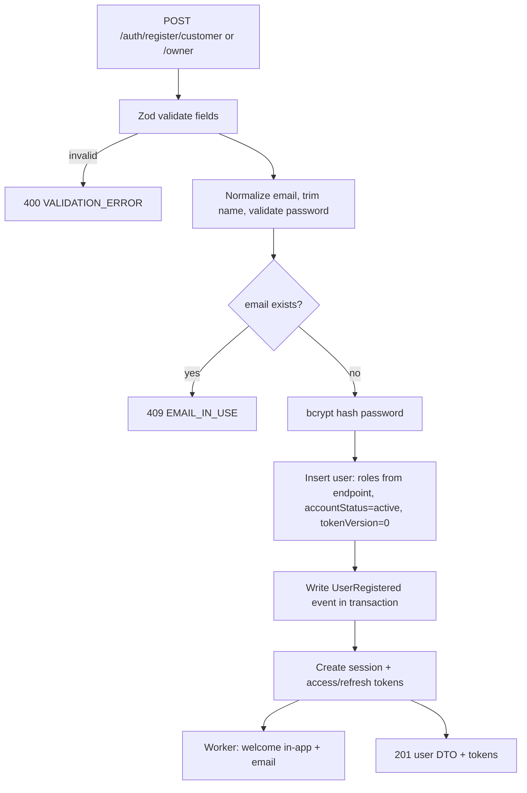
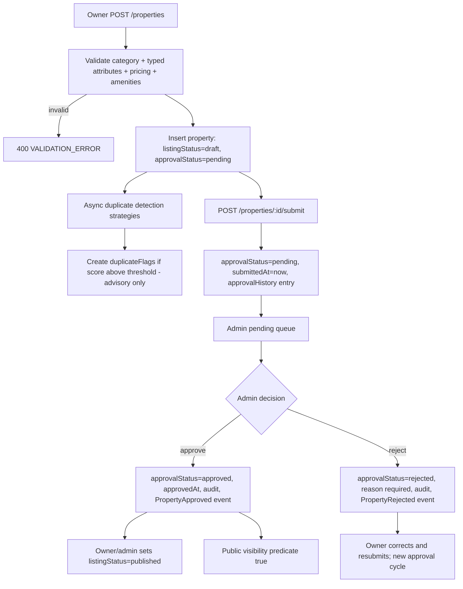
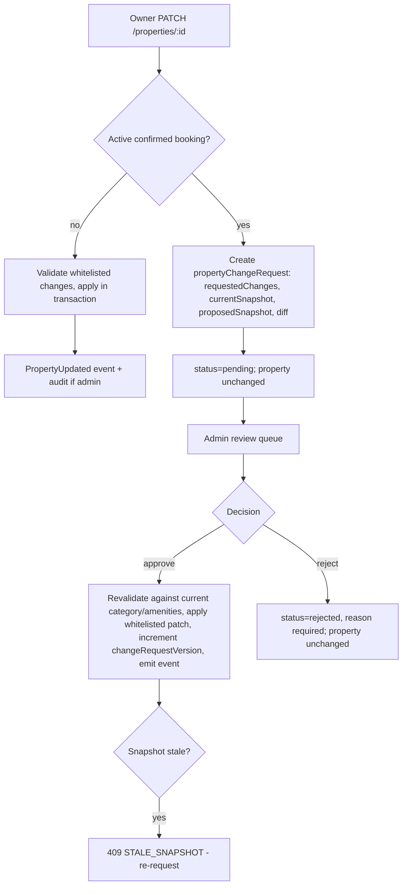
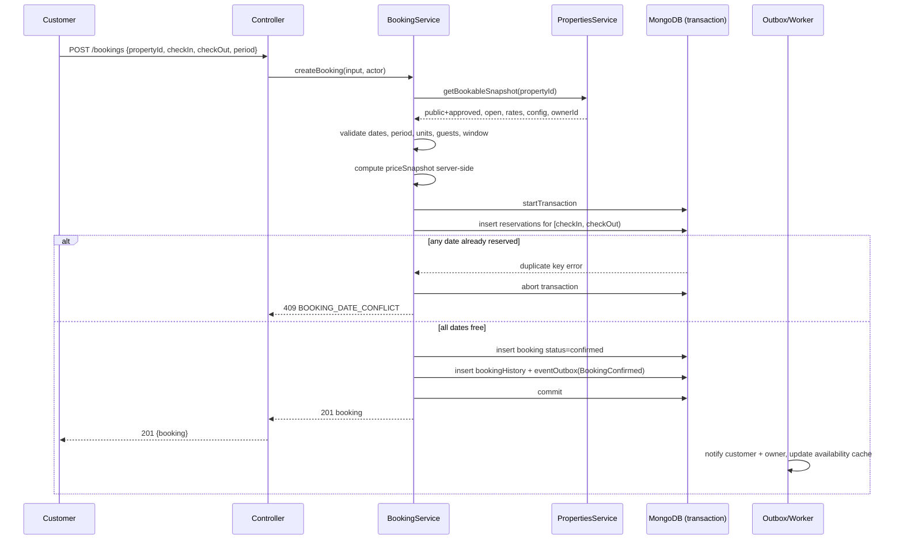
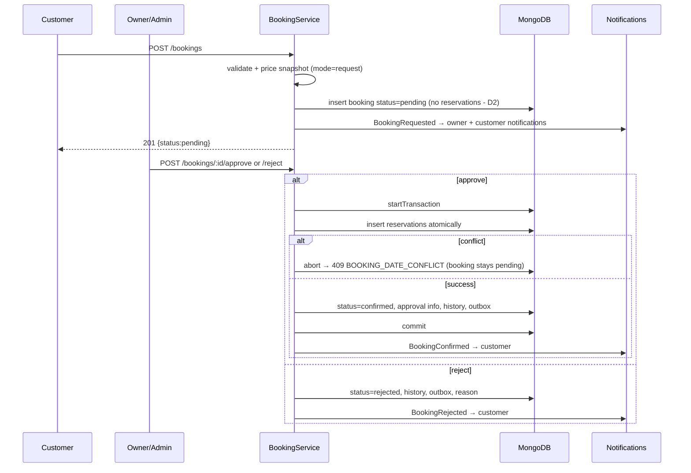
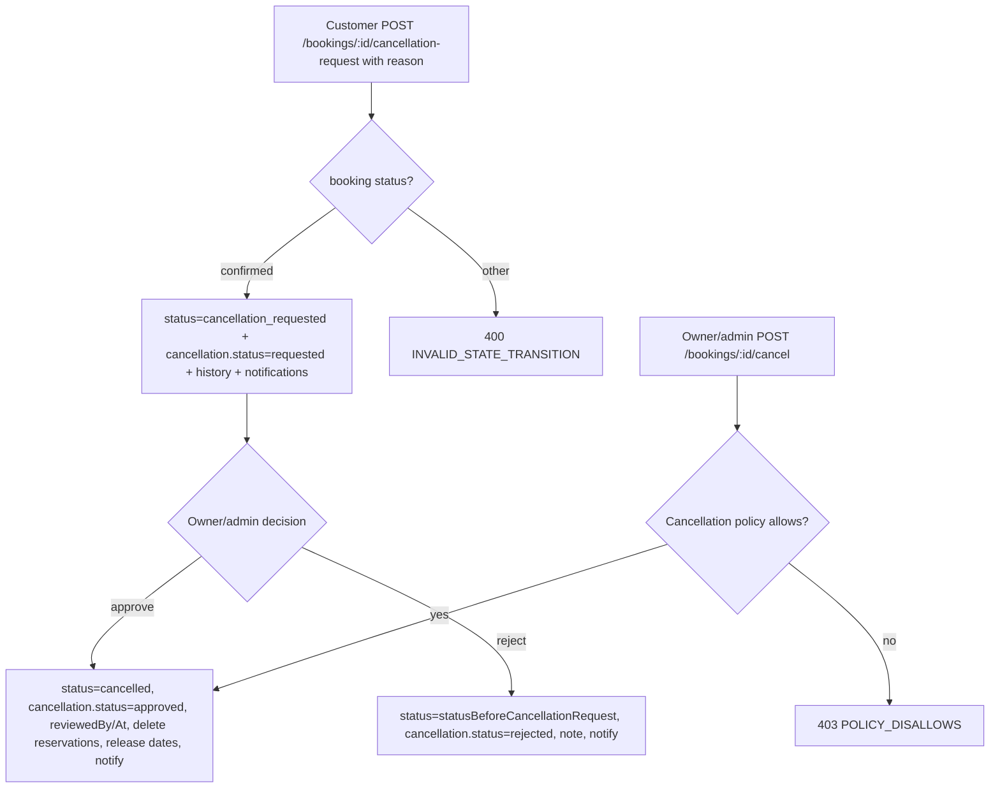
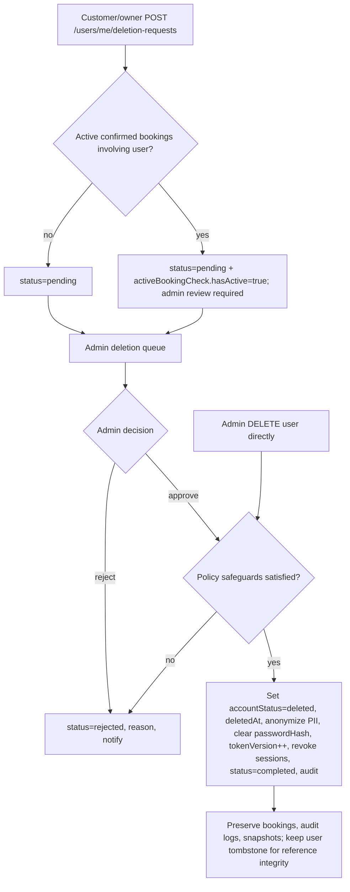
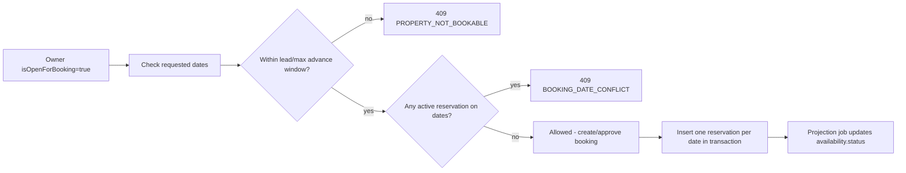

# Document 6 — Workflows and State Design (Phase 4)

## 1. User registration and authentication

Security notes: role is chosen by the endpoint, never the body; email enumeration is avoided on forgot-password; failed logins increment `failedLoginAttempts` and can set `lockedUntil`; refresh rotation revokes the family on reuse.

## 2. Property submission and approval

### Property lifecycle — three independent dimensions

```mermaid
stateDiagram-v2
  [*] --> Draft

  state "listingStatus" as Listing {
    [*] --> draft
    draft --> published : publish (requires approved)
    published --> archived : archive (owner: no active booking; admin: any)
    archived --> published : admin unarchive
    draft --> archived : admin archive
  }

  state "approvalStatus" as Approval {
    [*] --> pending
    pending --> approved : admin approve
    pending --> rejected : admin reject
    rejected --> pending : resubmit
    approved --> pending : material change resubmission (policy)
  }

  state "availability.status" as Availability {
    [*] --> available
    available --> booked : confirmed booking covers today
    booked --> available : booking cancelled/completed/past
    available --> unavailable : owner closes bookings or blocks all dates
    unavailable --> available : owner reopens
  }
```

Invalid transitions:
- `rejected → published` without a new approval.
- `archived → published` by a non-admin without approval checks.
- `booked → archived` by owner (requires admin path).
- Client-supplied status values on any write endpoint.
- `approved` without a recorded submit/approval history entry.

`availability.status` is a **cache** updated by the booking service and a nightly projection job. The authoritative state is `availabilityReservations` plus `availability.isOpenForBooking`.

## 3. Property editing while booked

Definition of "active confirmed booking" for this rule: `status = confirmed` **and** `checkOutDate > now`, including upcoming bookings. Price changes never rewrite existing `priceSnapshot` values.

## 4. Instant booking (atomic confirmation)

Boundary rule (D1): a booking occupying `[checkIn, checkOut)` reserves dates `checkIn … checkOut−1 day`. A new booking starting on the old `checkOut` date is allowed (same-day turnover). Monthly/yearly bookings are expanded to day-level reservations.

## 5. Request-based booking

Pending bookings do not hold dates in V1; availability is rechecked at approval. A conflict at approval returns `409` and keeps the request pending so the owner can ask the customer for different dates. Hold-with-expiry is a V2 policy.

## 6. Booking state machine

```mermaid
stateDiagram-v2
  [*] --> pending : request mode
  [*] --> confirmed : instant mode
  pending --> confirmed : owner/admin approve (availability recheck)
  pending --> rejected : owner/admin reject
  pending --> expired : policy/job (V2; disabled V1)
  confirmed --> cancellation_requested : customer requests cancellation
  confirmed --> cancelled : owner/admin cancel
  confirmed --> completed : owner/admin complete
  cancellation_requested --> cancelled : request approved
  cancellation_requested --> confirmed : request rejected (restore prior status)
  cancellation_requested --> cancelled : admin cancels directly
  rejected --> [*]
  cancelled --> [*]
  completed --> [*]
  expired --> [*]
```

| From | To | Allowed actor | Guard |
|---|---|---|---|
| pending | confirmed | owner of property, admin | Date recheck + reservation insert |
| pending | rejected | owner, admin | Reason required |
| pending | expired | job/admin | Policy enabled; V1 disabled |
| confirmed | cancellation_requested | customer (own), admin | Reason required |
| confirmed | cancelled | owner, admin | Policy allows; release reservations |
| confirmed | completed | owner, admin | `checkOut <= now` recommended |
| cancellation_requested | cancelled | owner, admin | Approve request; release reservations |
| cancellation_requested | confirmed | owner, admin | Reject request; restore `statusBeforeCancellationRequest` |

Invalid transitions: `rejected → confirmed` via customer action; `cancelled → confirmed`; `completed → cancelled` (unless admin correction with audit and explicit policy); `expired → confirmed`; any transition by an unauthorized actor; any direct model update bypassing the service.

## 7. Cancellation workflow

Policy service in V1:
- Customer requests never cancel a confirmed booking automatically.
- Owner may cancel a confirmed booking with a reason; admin may cancel any booking.
- Cancellation history is immutable; reservations are deleted in the same transaction.
- Refunds are out of scope; `payment.status` may be set to `not_applicable` or later updated by the future payment module via events.

## 8. Account deletion

Safeguards: active confirmed bookings block automatic completion (D9); historical bookings keep `customerId`/`ownerId` pointing to a tombstone plus their own snapshots; no cascade delete of properties/bookings/audit; owner properties are archived (not destroyed) on deletion; session/reset tokens revoked.

## 9. Availability lifecycle and date rules

- Authoritative occupancy: `availabilityReservations` documents (unique per property+date).
- Owner control: `availability.isOpenForBooking`, `leadTimeDays`, `maxAdvanceDays`, and owner-block reservations.
- Cached `availability.status` is derived from today's date vs. reservation ranges; public search filters use real reservations for the queried date range.
- Same-day turnover allowed (D1); check-in and check-out are date-only values.
- A booked property remains publicly visible; it simply rejects conflicting dates.
